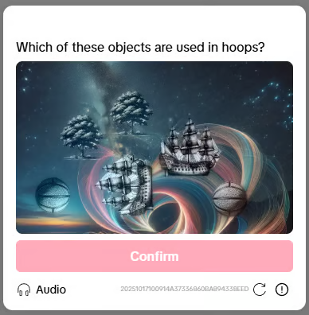

<Frame caption="Example Tiktok 3D Select Object captcha">
  
</Frame>

## 1. Create task

### Request

`POST https://api.omocaptcha.com/v2/createTask`

| Parameter | Type | Required | Description |
| --- | --- | :-: | --- |
| `clientKey` | String | ✅ | Client account key |
| `task.type` | String | ✅ | TiktokSelectObjectWebTask |
| `task.imageBase64` | String | ✅ | Captcha image encoded in base64 <br /> |
| `task.widthView` | Number | ✅ | Image width as displayed on the web page (not the original size) |
| `task.heightView` | Number | ✅ | Image height as displayed on the web page (not the original size) |
| `task.question` | String | ✅ | Câu hỏi của captcha (ví dụ: Which of these objects are used in hoops?) |

<Info>
  `widthView` and `heightView` are the **rendered** dimensions of the image on the page, not the original image size. Use the browser's Inspect element tool to get the correct values.
</Info>

<CodeGroup>

```bash cURL
curl -X POST https://api.omocaptcha.com/v2/createTask \
  -H "Content-Type: application/json" \
  -d '{
    "clientKey": "OMO_API_KEY",
    "task": {
      "type": "TiktokSelectObjectWebTask",
      "imageBase64": "BASE64_BODY_HERE",
      "widthView": 340,
      "heightView": 212,
      "question": "Which of these objects...?"
    }
  }'
```

```javascript Node.js
const res = await fetch("https://api.omocaptcha.com/v2/createTask", {
  method: "POST",
  headers: { "Content-Type": "application/json" },
  body: JSON.stringify({
    clientKey: "OMO_API_KEY",
    task: {
      type: "TiktokSelectObjectWebTask",
      imageBase64: "BASE64_BODY_HERE",
      widthView: 340,
      heightView: 212,
      "question": "Which of these objects...?"
    },
  }),
});
const data = await res.json();
console.log(data);
```

```python Python
import requests

res = requests.post(
    "https://api.omocaptcha.com/v2/createTask",
    json={
        "clientKey": "OMO_API_KEY",
        "task": {
            "type": "TiktokSelectObjectWebTask",
            "imageBase64": "BASE64_BODY_HERE",
            "widthView": 340,
            "heightView": 212,
            "question": "Which of these objects...?"
        },
    },
)
print(res.json())
```

```php PHP
<?php
$ch = curl_init("https://api.omocaptcha.com/v2/createTask");
curl_setopt($ch, CURLOPT_POST, true);
curl_setopt($ch, CURLOPT_HTTPHEADER, ["Content-Type: application/json"]);
curl_setopt($ch, CURLOPT_POSTFIELDS, json_encode([
    "clientKey" => "OMO_API_KEY",
    "task" => [
        "type" => "TiktokSelectObjectWebTask",
        "imageBase64" => "BASE64_BODY_HERE",
        "widthView" => 340,
        "heightView" => 212,
        "question": "Which of these objects...?"
    ],
]));
curl_setopt($ch, CURLOPT_RETURNTRANSFER, true);
$response = curl_exec($ch);
curl_close($ch);
echo $response;
```

</CodeGroup>

### Response

**Success:**

```json
{
  "errorId": 0,
  "taskId": "49f9f60a-c809-4af0-93c0-0409b72e67e0"
}
```

The server returns `errorId = 0` and the `taskId` on success.

**Failure:**

```json
{
  "errorId": 1,
  "errorCode": "",
  "errorDescription": ""
}
```

The server returns `errorId = 1` with an `errorCode`. See [Error codes](/en/api/error-codes) for details.

## 2. Get task result

### Request

`POST https://api.omocaptcha.com/v2/getTaskResult`

```json
{
  "clientKey": "OMO_API_KEY",
  "taskId": "49f9f60a-c809-4af0-93c0-0409b72e67e0"
}
```

### Response

**Success:**

```json
{
  "errorId": 0,
  "status": "ready",
  "solution": {
    "pointA": { "x": 50, "y": 30 },
    "pointB": { "x": 100, "y": 70 }
  }
}
```

The server returns `errorId = 0` and `status = ready`. Read the result from `solution`:

- `pointA` — coordinates of the first object (x, y), relative to the `widthView`/`heightView` you sent.
- `pointB` — coordinates of the second object.

Click both points on the image to complete the captcha.

**Processing:**

```json
{
  "errorId": 0,
  "status": "processing",
  "errorCode": "",
  "errorDescription": ""
}
```

The server returns `status = processing`. Wait ~2 seconds and call `getTaskResult` again.

**Failure:**

```json
{
  "errorId": 1,
  "errorCode": "ERROR_JOB_STATUS",
  "errorDescription": "Job failed",
  "status": "fail",
  "solution": {}
}
```

The server returns `errorId = 1` and `status = fail`.
